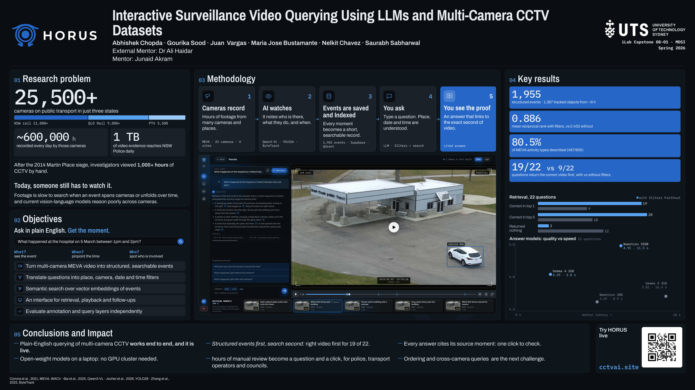

# Horus — RAG Layer (`ilabs-cctv-rag`)


The retrieval-augmented generation (RAG) layer behind **Horus**, a system for asking questions about multi-camera CCTV footage in plain English, for example _"What happened at the hospital on 5 March between 1pm and 2pm?"_. It embeds the structured events produced by the annotation pipeline from the [MEVA](https://mevadata.org/) dataset with `bge-base-en-v1.5`, indexes them in Qdrant and extracts place, camera, date and time filters from each question by rule. It then narrows the index with those filters before ranking by meaning and asks an LLM for an answer that cites every event it used. Metadata filtering raised top-1 retrieval accuracy from 9 to 19 of 22 test questions. The layer ships as an installable package with a single entry point, `answer_query()`, which the backend calls in-process.

**Live app:** [cctvai.site](https://cctvai.site) · **Live API:** [surveillance-api.nelkit.dev/docs](https://surveillance-api.nelkit.dev/docs)

---

## 🎬 Demo

### Showcase poster

[](docs/media/poster/poster-dark.png)

_Click the image to open the full-resolution poster (8164 × 4592)._

---

## Table of Contents

- [Overview](#-overview)
- [System Architecture](#️-system-architecture)
- [Local Setup](#-local-setup)
- [Environment Variables](#-environment-variables)
- [Usage](#-usage)
- [Evaluation](#-evaluation)
- [Data Sources](#️-data-sources)
- [Retrieval Pipeline](#-retrieval-pipeline)
- [Indexing and Scripts](#-indexing-and-scripts)
- [Releasing a New Version](#️-releasing-a-new-version)
- [Known Limitations](#️-known-limitations)
- [Team](#-team)
- [Links](#-links)

---

## 🧭 Overview

- **Subject:** 36105 iLab: Capstone Project, Spring 2026 (UTS)
- **Project:** 08-01 Interactive Surveillance Video Querying Using LLMs and Multi-Camera CCTV Datasets
- **Scope:** 1,955 structured events from 71 MEVA development clips (about 5.9 hours from 23 cameras at four sites: school, bus, hospital and admin), recorded on 5 and 7 March 2018
- **Package:** distribution `ilabs-cctv-rag`, module `rag`, installed by the backend from a git tag
- **Live app:** [cctvai.site](https://cctvai.site)
- **Design document:** [`docs/rag-design.md`](docs/rag-design.md)

The annotation pipeline writes each moment of video as an event row in the Supabase `bronze` schema. `scripts/index_events.py` reads those rows, folds the caption, activity, object types, camera and site into one string and embeds it. It stores the 768-dimension vector in Qdrant together with a filterable payload. When a user asks a question on the frontend, the backend calls `answer_query(question)` from this package. The package extracts filters by rule, searches the filtered subset, renders the surviving events into a prompt with absolute clock times and asks the configured LLM for a short answer that cites each event as `[1]`, `[2]`. The backend then enriches each returned `event_id` from Postgres and streams the result to the browser.

This repo **does not** serve HTTP, verify users, run the vision-language model or store video. Those jobs belong to the sibling repositories below.

### Related repositories

All repositories live in the [uts-ilab-p08](https://github.com/uts-ilab-p08) organisation.

| Repository | Role |
|---|---|
| [videometa](https://github.com/uts-ilab-p08/videometa) | Annotation library: VLM window-significance filter (Qwen3-VL), YOLO26 + ByteTrack tracking, and VLM annotator that writes plain-English events with element coordinates |
| [video-annotation-pipeline](https://github.com/uts-ilab-p08/video-annotation-pipeline) | Runs videometa over the MEVA clips and loads events, objects and geometries into the Supabase `bronze` schema that this repo indexes |
| **[iLabs-capstone-rag](https://github.com/uts-ilab-p08/iLabs-capstone-rag) (this repo)** | RAG layer, packaged as `ilabs-cctv-rag`: bge-base embeddings, Qdrant index, rule-based filters, cited answers, retrieval and model evaluations |
| [surveillance-backend](https://github.com/uts-ilab-p08/surveillance-backend) | FastAPI service that installs this package and calls `answer_query()` in-process from its search and assistant endpoints |
| [cctv-query-frontend](https://github.com/uts-ilab-p08/cctv-query-frontend) | Next.js web app on Vercel: search, results workspace, video player with tracked boxes, assistant chat |

---

## 🏗️ System Architecture

```text
 INDEXING  (run by hand whenever the annotations change)

┌──────────────────────────┐    ┌──────────────────────┐    ┌──────────────────────┐
│ Supabase Postgres        │    │ rag/text.py          │    │ rag/embed.py         │
│ bronze.events · videos   │──► │ caption + activity   │──► │ bge-base-en-v1.5     │
│ event_objects · objects  │    │ + objects + camera   │    │ fastembed (ONNX)     │
│ (rag/db.py)              │    │ + site               │    │ 768 dims, no GPU     │
└──────────────────────────┘    └──────────────────────┘    └──────────┬───────────┘
                                                                       │ upsert
                                                                       ▼
                               ┌──────────────────────────────────────────────────┐
                               │ Qdrant collection  meva_events  (rag/store.py)   │
                               │ one point per event, ID derived from event_id    │
                               │ payload: scene · camera_id · capture_date ·      │
                               │ start_time_of_day · caption · video_id · ...     │
                               └──────────────────────────┬───────────────────────┘
                                                          │ filtered search
 QUERY  (answer_query, called in-process by the backend)  │
                                                          ▼
┌──────────────┐   ┌──────────────────────────┐   ┌──────────────────────┐   ┌──────────────────────┐
│ question     │──►│ rag/filters.py           │──►│ rag/pipeline.py      │──►│ rag/llm.py           │
│ plain text   │   │ rag/temporal.py          │   │ filter first, then   │   │ OpenAI-compatible    │
│ from backend │   │ place, camera, date,     │   │ rank by similarity;  │   │ OpenRouter or Ollama │
└──────────────┘   │ time by rule, no model   │   │ floor 0.6 only when  │   │ cited answer, or a   │
                   │ vocabulary read from     │   │ nothing was filtered │   │ plain summary if the │
                   │ Qdrant                   │   │ top TOP_K events     │   │ LLM is unreachable   │
                   └──────────────────────────┘   └──────────────────────┘   └──────────┬───────────┘
                                                                                        ▼
                                                        { query, answer, sources, filters } ──► backend
```

The full rationale, the Qdrant point schema and the open questions are in [`docs/rag-design.md`](docs/rag-design.md).

---

## 🚀 Local Setup

### Before you start

| Requirement | Why |
|---|---|
| [uv](https://docs.astral.sh/uv/) | Manages the Python 3.11 environment and the lock file |
| A Qdrant instance | The vector index: the hosted cluster, a local Docker container or embedded mode (no install) |
| `DATABASE_URL` for the Supabase project | **Only for indexing.** Answering questions needs Qdrant and the LLM alone |
| An OpenRouter API key, or [Ollama](https://ollama.com/) running locally | Writes the answers. Optional: without it, answers fall back to a plain summary |
| Docker _(optional)_ | Only if you want Qdrant running locally as a container |

### Clone the repository

```bash
# SSH
git clone git@github.com:uts-ilab-p08/iLabs-capstone-rag.git

# HTTPS
git clone https://github.com/uts-ilab-p08/iLabs-capstone-rag.git

cd iLabs-capstone-rag
```

### Step 1 — Install dependencies _(required)_

```bash
uv sync
```

This creates `.venv` with the package and the dev group (Jupyter, pandas, matplotlib) used by the evaluation notebooks.

### Step 2 — Configure the environment _(required)_

```bash
cp .env.example .env            # macOS / Linux
Copy-Item .env.example .env     # Windows PowerShell
```

Then fill in the values described in [Environment Variables](#-environment-variables).

### Step 3 — Choose where Qdrant runs _(required)_

`QDRANT_URL` decides it:

| `QDRANT_URL` | What runs | Notes |
|---|---|---|
| Hosted cluster URL | The shared project index | What the project uses, so the backend and your laptop share one index. Put the key in `QDRANT_API_KEY` |
| `http://localhost:6333` | The container in `docker-compose.yml` | Start it with `docker compose up -d qdrant`. Dashboard at <http://localhost:6333/dashboard> |
| empty | Embedded mode against `./qdrant_data` | No Docker. Single process only, and payload indexes are ignored, so filtering falls back to scanning |

### Step 4 — Build the index _(only for a new or empty Qdrant)_

```bash
uv run scripts/index_events.py
```

Needs `DATABASE_URL`. It is safe to re-run: point IDs come from `event_id`, so a second run overwrites rather than duplicates.

### Step 5 — Ask a question

```bash
uv run scripts/ask.py "anything at the hospital on March 5 between 1pm and 2pm?"
```

Prints the same response the backend receives. For raw ranked results without the LLM, use `uv run scripts/search.py "white truck" --limit 10`.

---

## 🔐 Environment Variables

All settings are read once from `.env` (or the host environment) in [`src/rag/config.py`](src/rag/config.py).

```bash
cp .env.example .env            # macOS / Linux
Copy-Item .env.example .env     # Windows PowerShell
```

### Required — for answering questions

| Variable | Description |
|---|---|
| `QDRANT_URL` | Qdrant server URL. Leave empty for embedded mode (see [Step 3](#step-3--choose-where-qdrant-runs-required)) |
| `QDRANT_API_KEY` | API key for the hosted cluster. Not needed for local Docker or embedded mode |
| `LLM_MODEL` | Model id, for example `nvidia/nemotron-3-ultra-550b-a55b` on OpenRouter or `qwen3:4b` on Ollama. Leave empty to skip the LLM and return a plain summary |
| `LLM_API_KEY` | OpenRouter key (`sk-or-...`). Leave empty for Ollama |

### Required — for indexing only

| Variable | Description |
|---|---|
| `DATABASE_URL` | Supabase Postgres connection string. A query-only deployment (the backend on Render) runs without it |

### Optional (with defaults)

| Variable | Default | Description |
|---|---|---|
| `LLM_BASE_URL` | `https://openrouter.ai/api/v1` | Any OpenAI-compatible endpoint. Use `http://localhost:11434/v1` for Ollama |
| `TOP_K` | `5` | Events returned per query, and how many the LLM sees as context |
| `QDRANT_COLLECTION` | `meva_events` | Collection name |
| `DB_SCHEMA` | `bronze` | Postgres schema read by the indexer |
| `EMBED_MODEL` | `BAAI/bge-base-en-v1.5` | fastembed model. Changing it means re-indexing from scratch |
| `EMBED_DIM` | `768` | Must match `EMBED_MODEL`. A collection's vector size is fixed at creation |

### Choosing the LLM

OpenRouter and Ollama both speak the OpenAI chat-completions API, so the model is configuration, not code:

| | OpenRouter (hosted) | Ollama (local) |
|---|---|---|
| `LLM_BASE_URL` | `https://openrouter.ai/api/v1` | `http://localhost:11434/v1` |
| `LLM_MODEL` | `<vendor>/<model>` | `qwen3:4b` |
| `LLM_API_KEY` | `sk-or-...` | leave empty |

Requests use `temperature=0` and `max_tokens=2000`. The limit is generous because reasoning models spend tokens thinking first; set too low, they hit the cap mid-thought and return nothing.

---

## 💻 Usage

### From the backend

The backend needs one function. It owns all HTTP; this package never does.

```python
from rag.pipeline import answer_query

response = answer_query("anything at the hospital on March 5 between 1pm and 2pm?")
```

The backend installs the package from a git tag in its `requirements.txt`:

```text
ilabs-cctv-rag @ git+https://github.com/uts-ilab-p08/iLabs-capstone-rag.git@vX.Y.Z
```

### Response contract

`response` is JSON-serialisable:

```json
{
  "query": "anything at the hospital on March 5 between 1pm and 2pm?",
  "answer": "A white SUV left the parking area at 13:16 [1]...",
  "sources": [
    {
      "score": 0.649,
      "annotation": "A person in a dark jacket is seen exiting a white SUV...",
      "video_id": "20c38d5f...",
      "event_id": "b159b039..."
    }
  ],
  "filters": {
    "scenes": ["hospital"],
    "cameras": [],
    "dates": ["2018-03-05"],
    "time_of_day": [46800, 50400],
    "notes": []
  }
}
```

- `sources` holds the best `TOP_K` events, best first. Anything beyond these four fields (location, camera, timestamps) is looked up in Postgres by `event_id`.
- `annotation` is the caption, `bronze.events.description`.
- `answer` cites the events it used as `[1]`, `[2]`, matching the order of `sources`. Citations are not guaranteed, since weaker models sometimes omit them, so the frontend must not depend on them.
- No match returns `"sources": []` and an answer saying no footage was found.
- If the LLM is unreachable, `answer` degrades to a plain summary instead of raising, so the endpoint never fails because of the model.
- `filters` is diagnostic: what was filtered on, with `time_of_day` as seconds since midnight, plus `notes` on anything deliberately ignored. It lets the interface say "searched hospital only".

---

## 🧪 Evaluation

Retrieval and answer generation are evaluated separately, so a wrong answer can be traced to the layer that caused it. Both reports are in [`eval/`](eval/).

### Retrieval evaluation

[`eval/retrieval-evaluation.md`](eval/retrieval-evaluation.md) · code and charts in [`eval/evaluation.ipynb`](eval/evaluation.ipynb) · questions in [`eval/questions.csv`](eval/questions.csv)

Thirty questions: 22 answerable (plain lookup, location, camera, date, time and combined filters), 5 about things absent from the footage and 3 ambiguous or negated ones that should be left unfiltered. It is scored on the events returned by search, before any LLM is involved. The answer key is lexical while retrieval is semantic, so these scores are a lower bound.

| Condition | Hit@1 | Hit@3 | Hit@5 | out of | MRR | returned nothing |
|---|---|---|---|---|---|---|
| **Filters on** | 19 | 20 | 20 | 22 | **0.886** | 2 |
| **Filters off** | 9 | 10 | 10 | 22 | 0.432 | 12 |

Four of the 5 negative questions correctly returned nothing, and all 3 ambiguous or negated questions were left unfiltered with the reason recorded.

```bash
uv run jupyter lab eval/evaluation.ipynb
```

### Answer-generation model comparison

[`eval/model-comparison.md`](eval/model-comparison.md) · code and charts in [`eval/model_comparison.ipynb`](eval/model_comparison.ipynb)

Four models answered the same 15 questions, twice each (151 responses). Context was retrieved once per question and given identically to every model, so the model is the only thing that varies. An LLM judge from outside the candidate set (Claude) scored correctness, faithfulness and usefulness from 1 to 5, with a written justification for each score in [`eval/judge_scores.csv`](eval/judge_scores.csv).

| Model | Judge mean (of 5) | Calls per answer | Median latency |
|---|---|---|---|
| **nvidia/nemotron-3-ultra-550b-a55b** | **4.91** | 1.00 | 11.5 s |
| google/gemma-4-26b-a4b-it | 4.29 | 1.13 | **3.8 s** |
| google/gemma-4-31b-it | 3.81 | 12.85 | 16.4 s |
| nvidia/nemotron-3-nano-omni-30b-a3b-reasoning | 3.69 | 1.40 | 8.9 s |

**Recommendation:** Nemotron 550B for quality; Gemma 4 26B as the fast alternative for demos and iteration.

```bash
uv run eval/collect_responses.py      # collect answers → eval/model_responses.json (resumable)
uv run jupyter lab eval/model_comparison.ipynb
```

`collect_responses.py` is safe to re-run: it keeps work already done and only collects what is missing, because the free OpenRouter endpoints fail often. The automatic measures (citations, rule compliance, grounding, extractiveness) live in [`eval/measures.py`](eval/measures.py).

---

## 🗃️ Data Sources

| Source | Type | Volume | Script |
|---|---|---|---|
| [MEVA](https://mevadata.org/) audited subset, via the annotation pipeline | Structured events in Supabase Postgres (`bronze.events`, `videos`, `event_objects`, `objects`) | 1,955 events from 71 clips, 23 cameras, 4 sites, 2 dates | [`scripts/index_events.py`](scripts/index_events.py) |
| Qdrant collection `meva_events` | Derived vector index | One 768-dimension point per event | rebuilt by `index_events.py` |

The events are produced upstream by [video-annotation-pipeline](https://github.com/uts-ilab-p08/video-annotation-pipeline) using [videometa](https://github.com/uts-ilab-p08/videometa). This repo never reads the MEVA annotation files; they are used only as the evaluation reference upstream. Nothing from the database or the index is committed: `qdrant_data/` and `qdrant_storage/` are git-ignored, and the index can be deleted and rebuilt from Postgres in minutes.

---

## 🤖 Retrieval Pipeline

### What gets embedded

Each event is embedded as one composed string, not the caption alone, because a question such as _"a vehicle at the bus stop"_ must match on place and object type, and neither necessarily appears in the caption:

```text
<caption>
Activity: <event name>. Objects: <object types>.
Camera: <camera_id> (<scene>).
```

- **Model:** `BAAI/bge-base-en-v1.5` through fastembed (ONNX, no PyTorch, no GPU), 768 dimensions.
- **Store:** Qdrant with HNSW search. Payload indexes on `scene`, `camera_id`, `capture_date`, `start_time_of_day`, `object_types`, `start_seconds`, `end_seconds`, `start_timestamp` and `source_status`.
- The raw caption stays in the payload separately; it is what the user sees and what the LLM reads.

### Metadata filtering

A question naming a location, camera, date or time of day is filtered **before** ranking, and several filters combine.

| Names | Filters on | Understands |
|---|---|---|
| a location | `scene` | `school`, plus synonyms `campus`, `clinic`, `depot` |
| a camera | `camera_id` | `G341`, several at once |
| a date | `capture_date` | `2018-03-07`, `March 7`, `7 March`, `the 7th` |
| a time | `start_time_of_day` | `2-4pm`, `between 13:00 and 14:00`, `after 2pm`, `before 11am`, `at 2pm` |

- **Rule-based only:** no model call, so it adds no latency and is deterministic.
- **Vocabulary from Qdrant, not Postgres:** it must describe what is *searchable*. It is read fresh on every query, so re-indexing makes a new location filterable with no restart.
- **Time of day has its own field**, because "2-4pm" across two days is two disjoint windows.
- **Object types are not filtered on:** the same vehicle appears as `car` in one event and `truck` in another.

Every rule prefers no filter over a wrong one. A wrong filter reports "no matching footage" about footage that exists; a missed one only leaves results broader. These cases fall back to unfiltered search and say why in `filters.notes`:

- **Ambiguous location:** "was there a school bus?" names two locations.
- **Negation:** "anything except the school".
- **Ambiguous time:** "2-4" could be 02:00 or 14:00; only an explicit `am`/`pm` or an hour of 13+ is unambiguous.
- **Ambiguous date:** "the 7th" when several indexed dates fall on a 7th.

A fully written date that is not in the index still filters and returns nothing; "nothing was recorded that day" is the honest answer.

### The similarity floor

```text
floor = 0.0   if a filter matched
        0.6   otherwise (MIN_SCORE in rag/pipeline.py)
```

When a filter matches, the filter is the relevance signal and the floor is dropped. This is what makes scope questions work: no single caption resembles "what happened at the hospital", so every relevant hospital event scores around 0.45–0.50 and a fixed floor would discard them all.

### Answer generation

The surviving events go into a prompt that leads with the closest match, gives each event an absolute clock time instead of a clip offset, and warns that detector labels are unreliable. Its central rule concerns identity: cameras overlap and share a clock, so the model judges by site and clock time, not camera name. Events at one site with overlapping times are treated as one occurrence filmed twice. Events at different sites are treated as different objects, however alike they read.

---

## 🔄 Indexing and Scripts

Run everything from the repository root with `uv run`.

```bash
# Postgres bronze.* → embed → Qdrant (needs DATABASE_URL; idempotent)
uv run scripts/index_events.py

# question → answer_query() → printed response (no backend needed)
uv run scripts/ask.py "was there a white SUV at the school on the 7th?"

# question → raw ranked Qdrant results, for debugging retrieval
uv run scripts/search.py "person getting out of a car" --limit 10

# read-only exploration of the source schema (needs DATABASE_URL)
uv run scripts/inspect_schema.py     # tables, columns, row counts
uv run scripts/explore_bronze.py     # distincts, joins, sample JSON
```

Re-index whenever the annotations change. If a change alters the vector size (`EMBED_MODEL` / `EMBED_DIM`) or what gets embedded, rebuild the collection against the hosted Qdrant **before** the backend is bumped to that version.

### Layout

```text
src/rag/
  config.py    settings from .env
  db.py        fetch events from the Supabase bronze schema
  text.py      compose the string that gets embedded
  embed.py     bge-base-en-v1.5 via fastembed (ONNX, no PyTorch)
  store.py     Qdrant collection, payload schema, upsert, search
  filters.py   location and camera filters from a question
  temporal.py  dates and clock ranges from a question
  llm.py       one client for OpenRouter and Ollama
  pipeline.py  answer_query(query) -> response   ← what the backend calls
scripts/       index_events, ask, search, inspect_schema, explore_bronze
eval/          retrieval and model-comparison evaluations
docs/          rag-design.md
```

---

## ☁️ Releasing a New Version

This package is not deployed on its own. The backend ([surveillance-backend](https://github.com/uts-ilab-p08/surveillance-backend), on Render) installs it from a git tag, and the index lives on a hosted Qdrant cluster. There is no PyPI upload: pip clones the repo at the tag and builds the wheel itself, so **whatever is in the tagged commit is exactly what gets installed**.

**Step 1 — Bump `version` in `pyproject.toml`** to match the tag (`v0.1.7` ↔ `version = "0.1.7"`) and refresh the lock file:

```bash
uv lock
```

**Step 2 — Check it installs from outside the repo.** `uv run` imports from `src/` and never builds a wheel, so it cannot catch packaging mistakes:

```bash
rm -rf dist && uv build
python -m venv /tmp/rag-check && /tmp/rag-check/bin/pip install dist/*.whl
/tmp/rag-check/bin/python -c "from rag.pipeline import answer_query; print('RAG package OK')"
```

**Step 3 — Commit and push first, then tag.** A tag points at a commit, not your working tree:

```bash
git add pyproject.toml uv.lock
git commit -m "chore(release): v0.1.7"
git push origin main
git tag v0.1.7
git push origin v0.1.7
```

**Step 4 — Confirm the tag points at your commit:**

```bash
git ls-remote --tags origin      # v0.1.7 must show the same hash as:
git rev-parse HEAD
```

**Step 5 — Bump the pin in the backend** (`requirements.txt`: `@v0.1.6` → `@v0.1.7`). Render picks it up on its next deploy.

Never move or delete a published tag; the backend or someone's venv may already be pinned to it. If a release is broken, publish the next patch version.

On the backend host, set `QDRANT_URL`, `QDRANT_API_KEY`, `LLM_MODEL`, `LLM_API_KEY` and optionally `TOP_K`. `DATABASE_URL` is not needed there.

---

## ⚠️ Known Limitations

- **No ordering questions.** "What happened after the van arrived" and sequences across cameras are not supported; filters cover place, camera, date and time only.
- **One camera at a time.** Events are not linked across views, so one incident filmed by two cameras comes back twice and counts can be inflated. The prompt asks the model to hedge, but the index holds no link between sightings.
- **A location filter can let a negative question through.** "Did an ambulance arrive at the hospital?" returns hospital footage: the filter fires, the floor drops, and five hospital events come back for an ambulance no caption mentions.
- **MEVA-specific vocabulary.** The filter rules know only MEVA's four sites, its cameras and two dates; a new environment needs a new vocabulary.
- **The retrieval test set is not blind.** The 30 questions were written against the indexed captions and scored with a lexical key, so scores are a lower bound on this corpus, not an estimate elsewhere.
- **Not built:** hybrid keyword-plus-vector search, LLM-based filter extraction with rules as fallback, the embedding-model benchmark (BGE vs Qwen vs Arctic-Embed) and automated tests.

---

## 👥 Team

| Member | Primary contributions |
|---|---|
| Abhishek Chopda | **RAG lead; retrieval and model evaluation lead.** Built this layer end to end: ingestion from Supabase, bge-base embeddings via fastembed, the idempotent Qdrant index, rule-based filters that prefer no filter over a wrong one, the cited-answer prompt and the `ilabs-cctv-rag` package. Designed and ran the 30-question retrieval evaluation and the four-model answer comparison |
| Gourika Sood | Backend lead. Postgres event store and the FastAPI search and assistant endpoints that call this package in-process; traced the `/search` retrieval limit across the backend and RAG codebases |
| Nelkit Chavez | Frontend lead, integration and deployment. Connected the frontend to the backend that reaches this layer, so the full system runs live at cctvai.site; project coordination |
| Juan Sebastian Vargas | Video annotation lead. videometa library and annotation pipeline that produce the `bronze` events this repo indexes |
| Maria Jose Bustamante | Evaluation lead. MEVA reference data, event matching, data audits and the first candidate retrieval question sets |
| Saurabh Sabharwal | Evaluation (annotation QA). LLM-judge QA pipeline, rubric, temporal IoU, human-in-the-loop review |

**Client:** Dr Ali Haidar · **Mentor:** Junaid Akram

---

## 🔗 Links

- Live app: [cctvai.site](https://cctvai.site)
- Live API docs: [surveillance-api.nelkit.dev/docs](https://surveillance-api.nelkit.dev/docs)
- Demo walkthrough (4K): [media.nelkit.dev](https://media.nelkit.dev/projects/demos/horus-demo-loop-4k-dark.mp4)
- Showcase poster: [`docs/media/poster/poster-dark.png`](docs/media/poster/poster-dark.png)
- Design document: [`docs/rag-design.md`](docs/rag-design.md)
- Organisation: [github.com/uts-ilab-p08](https://github.com/uts-ilab-p08)
- MEVA dataset: [mevadata.org](https://mevadata.org/)

---

<p align="center"><sub>36105 iLab: Capstone Project | Master of Data Science and Innovation | University of Technology Sydney · Spring 2026</sub></p>
